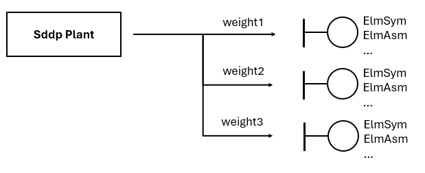

# Plant dispatch

This script distribute Sddp plant's generation in PowerFactory generators.


## Requirements

- PowerFactory 15 or newer
- Python 3.10 or newer
  - [psr-factory](https://docs.psr-inc.com/factory/)
    - `pip install psr-factory`
    - requires a valid PSR license


### Making `powerfactory` importable

The `powerfactory` module ships with PowerFactory and can't be installed with
`pip`. Add the PowerFactory Python folder that matches your Python version to
`PYTHONPATH` before running the script, for example:

```bat
set PYTHONPATH=C:\Program Files\DIgSILENT\PowerFactory 2024\Python\3.10;%PYTHONPATH%
```

Adjust the PowerFactory version and Python version in the path to your
installation. The PowerFactory and Python versions must be compatible (both
64-bit, and a Python version supported by your PowerFactory release).


## Usage

1. Run Sddp with appropriate result files enabled
    - Thermal generation
    - Renewable generation
    - Hydro generation
    - Battery generation
    - CSP generation
    - Power injection output
2. [Create a CSV file mapping Sddp scenarios to PowerFactory scenarios](#scenario-names)
3. [Create a CSV file mapping Sddp plants to PowerFactory generator elements](#sddp-plantpowerfactory-elm-mapping)
4. Run the [sddp_plant_dispatch.py](sddp_plant_dispatch.py) script:

```bat
python sddp_plant_dispatch.py -p "Project Name" --path "C:\temp\sddp_case"
```

By default, the input CSV files are read from the SDDP case path. Use
`--scenarios` and `--plant-map` to point to files elsewhere, and `-v` to print
debug messages.

Scenarios that already exist in the PowerFactory project are updated instead
of duplicated.

To check the values before changing the PowerFactory project, run with
`--dry-run`. It prints the power in MW assigned to each element in each
scenario as CSV, without connecting to PowerFactory:

```bat
python sddp_plant_dispatch.py --path "C:\temp\sddp_case" --dry-run > dispatch.csv
```

The [examples](./examples) folder has sample `scenario_names.csv` and
`plant_elm_map.csv` files.


### Input files

The following input files are required to run the script:

| Input File                                               | Description                                         |
|:---------------------------------------------------------|:----------------------------------------------------|
| [scenario_names.csv](#scenario-names)                    | Maps Sddp scenarios to PowerFactory scenario names  |
| [plant_elm_map.csv](#sddp-plantpowerfactory-elm-mapping) | Maps Sddp plants to PowerFactory generator elements |


#### Scenario names

Maps a Sddp scenario to a PowerFactory scenario name. The file name is
`scenario_names.csv` and its first line is a header.

|     Column      | Description                 |
|:---------------:|:----------------------------|
|  Stage Number   | Sddp stage number           |
| Scenario Number | Sddp scenario number        |
|  Block Number   | Sddp block or hour number   |
|  Scenario Name  | PowerFactory scenario name  |


#### Sddp Plant/PowerFactory Elm* mapping

It's possible to distribute Sddp Plants' generation in multiple PowerFactory generators using weights. The figure below illustrates it.




Weights of a plant are normalized, so they don't need to add up to 1. A
PowerFactory element may receive generation from more than one Sddp plant; the
contributions are summed.

The file name is `plant_elm_map.csv`, its first line is a header and its
columns are:

|   Column   | Description                                                          |
|:----------:|:---------------------------------------------------------------------|
| System ID  | String with Sddp system id                                           |
| Plant Type | String with Sddp plant type                                          |
| Plant Name | String with Sddp plant name                                          |
|   Weight   | Distribution weight of plant power to powerfactory generator element |
|  Element   | PowerFactory generator element name in `name.class` format           |


Supported plant types:

| Plant Type | Description                    |
|:----------:|:-------------------------------|
|   hydro    | Hydro plant                    |
|  thermal   | Thermal plant                  |
| renewable  | Renewable plant                |
|  battery   | Battery                        |
|    csp     | Concentrated solar power plant |
| injection  | Injection                      |


Supported PowerFactory generator classes:

|   Class    | Modified Attribute |
|:----------:|:-------------------|
|   ElmSym   | `pgini`            |
|   ElmAsm   | `pgini`            |
| ElmGenstat | `pgini`            |
|  ElmAsmsc  | `pgini`            |
|  ElmPvsys  | `pgini`            |
|  ElmXnet   | `pgini`            |
